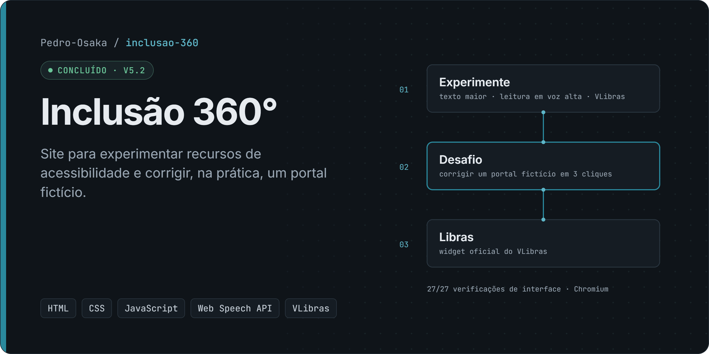
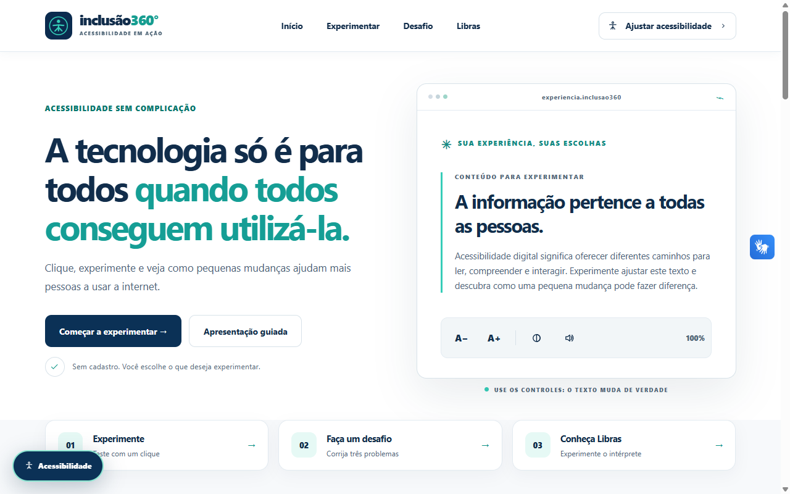

# Inclusão 360°

> **Status: concluído (v5.2).** Projeto acadêmico **individual**.
> **Demo ao vivo:** https://pedro-osaka.github.io/inclusao-360/

Site demonstrativo de **acessibilidade digital**: em vez de só explicar o tema, ele deixa o visitante experimentar recursos de acessibilidade e corrigir, ele mesmo, um portal fictício cheio de problemas.

**[Demo ao vivo](https://pedro-osaka.github.io/inclusao-360/)** · **[Portfólio](https://pedro-osaka.github.io/portfolio/)** · **[Perfil no GitHub](https://github.com/Pedro-Osaka)**

## Problema

Acessibilidade costuma ser apresentada como uma lista de regras. Quem nunca usou uma tecnologia assistiva tem dificuldade de entender por que contraste, texto alternativo ou navegação por teclado importam.

## Funcionalidades

1. **Experimente:** três recursos principais (texto maior, leitura em voz alta e VLibras) e dois exemplos extras (legendas e teclado).
2. **Desafio:** corrigir em três cliques um portal fictício com texto ruim, contraste fraco e link impreciso.
3. **Libras:** selecionar frases e traduzi-las com o **widget oficial do VLibras**.

O botão **Ajustar acessibilidade** fica sempre disponível: tamanho do texto, modos de cor, leitura simples, redução de distrações e restauração dos padrões. Há também uma **apresentação guiada em quatro etapas**. Em **Mostrar mais recursos** ficam perfis, um comparador antes/depois, desafios de teclado e contraste, um formulário acessível e um verificador educativo de HTML.

## Tecnologias

- **HTML, CSS e JavaScript puros**, sem frameworks e sem etapa de build: o site roda em qualquer servidor estático.
- **Web Speech API** para a leitura em voz alta, usando as vozes instaladas no sistema.
- **VLibras oficial**, carregado de `vlibras.gov.br`. Se o script falhar, a interface informa a indisponibilidade em vez de simular.
- **Vídeo local** (MP4) com legendas WebVTT em português.
- Preferências salvas no `localStorage`, quando o navegador permite. Não há cadastro, banco de dados nem envio de formulário.

| Arquivo | Papel |
|---|---|
| `index.html` | Estrutura e carregamento do VLibras |
| `styles.css`, `script.js` | Recursos-base de acessibilidade |
| `v3.css`, `v3.js` | Desafios, verificador, comparador e apresentação guiada |
| `v4.css`, `v4.js` | Navegação simplificada, agrupamento dos extras e ajustes de rodapé e mobile |
| `assets/` | Vídeo, legendas, poster e ícones (produzidos para o projeto) |
| `docs/` | [Guia de uso](docs/GUIA-DE-USO.md), [testes](docs/TESTES.md), [roteiro de apresentação](docs/ROTEIRO-APRESENTACAO.md) e [publicação/QR](docs/PUBLICAR-E-QR.md) |

## Demonstração

Página inicial publicada no GitHub Pages (captura de 13/11/2026). O projeto também inclui um vídeo demonstrativo com legendas em [`assets/video-demo.mp4`](assets/video-demo.mp4).



## Como executar

```powershell
git clone https://github.com/Pedro-Osaka/inclusao-360.git
cd inclusao-360
py -m http.server 8080        # ou: iniciar-site.bat
# abra http://localhost:8080
```

## Testes

**27 de 27 verificações aprovadas** em Chromium (detalhes em [`docs/TESTES.md`](docs/TESTES.md)): navegação em 3 passos, demonstrações, missão 3/3, tour, extras, menu mobile, ausência de rolagem horizontal de 320 a 1440 px (inclusive com o texto ampliado) e nenhuma exceção de JavaScript.

## Limitações e status

**Status atual: concluído (v5.2).**

- **Não é uma auditoria nem um selo WCAG.** Faltam testes com leitores de tela, em dispositivos reais e com pessoas com deficiência.
- O VLibras e a voz dependem de internet e das vozes do sistema, respectivamente.
- O verificador de HTML cobre quatro classes de problema, com fim educativo.

## Autor e créditos

**Pedro Henrique da Silva Pereira** · projeto individual · [Portfólio](https://pedro-osaka.github.io/portfolio/) · [LinkedIn](https://www.linkedin.com/in/pedrosilva-sistemas/)

Créditos de terceiros: o tradutor de Libras é o widget oficial do [VLibras](https://vlibras.gov.br/), carregado do site do governo federal. Vídeo, legendas, poster e ícones de `assets/` foram produzidos para o projeto.
